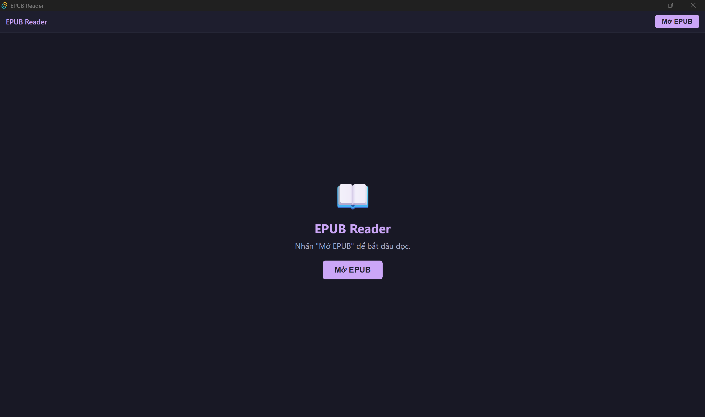

# 📖 EPUB Reader & Translate

Ứng dụng Windows Desktop giúp mở, đọc và dịch sách điện tử định dạng **EPUB** với mục tiêu giữ nguyên cấu trúc trình bày (XHTML, CSS, hình ảnh, font chữ, mục lục) tốt nhất có thể.

---

## ✨ Tính năng hiện tại (MVP 0.1 — Reader)

- **Mở file EPUB trực tiếp**: Chọn file `.epub` từ máy tính qua hộp thoại hệ thống (có kiểm tra chữ ký ZIP hợp lệ).
- **Chế độ đọc cuộn liên tục (Scrolled Continuous)**: Hiển thị nội dung 100% chiều rộng vùng đọc, cuộn mượt qua các chương.
- **Mục lục đa cấp (TOC Sidebar)**:
  - Hỗ trợ hiển thị cây mục lục nhiều cấp.
  - Nhảy chính xác tới đầu chương (đã xử lý tự động căn chỉnh sau khi tải ảnh trong chương).
  - Có thể đóng/mở thanh bên mục lục để tối ưu không gian đọc.
- **Ghi nhớ vị trí đọc (CFI)**: Tự động lưu và khôi phục vị trí đọc gần nhất cho từng file sách qua `localStorage`.
- **Xử lý lỗi an toàn**:
  - Kiểm tra magic bytes (`0x50 0x4B 0x03 0x04`) trước khi nạp.
  - Cơ chế timeout 20 giây và chống xung đột (race condition) khi mở nhiều file liên tiếp.
  - Hiển thị thông báo lỗi rõ ràng trên giao diện, không làm treo hay crash ứng dụng.
- **Bảo mật tối thiểu (Least Privilege)**: Chỉ cấp quyền Tauri tối thiểu cần thiết (`dialog:allow-open`, `fs:allow-read-file`, `fs:allow-exists`).

---

## 🖼️ Giao diện ứng dụng (Screenshots)

### 1. Màn hình chào mừng


### 2. Giao diện đọc sách & Mục lục (Scrolled Mode)


### 3. Cảnh báo lỗi khi mở file không hợp lệ


---

## 🛠️ Công nghệ sử dụng (Tech Stack)

- **Desktop Framework**: [Tauri 2](https://v2.tauri.app/) (Rust backend + WebView2)
- **Frontend**: React 19 + TypeScript + Vite
- **EPUB Engine**: `epubjs` (được bọc cô lập sau interface `ReaderEngine` — ADR-004)
- **Tauri Plugins**: `@tauri-apps/plugin-dialog`, `@tauri-apps/plugin-fs`

---

## 📂 Cấu trúc thư mục

```text
Epub file reader/
├── docs/                                 # Tài liệu thiết kế, ADR & trạng thái dự án
│   ├── DECISIONS.md                      # Các quyết định kiến trúc (ADR)
│   ├── PROJECT_STATE.md                  # Trạng thái tiến độ hiện tại
│   └── PROMPT_01_ANTIGRAVITY.md
├── src/
│   ├── lib/
│   │   └── reader-engine/                # Lớp trừu tượng hóa ReaderEngine (ADR-004)
│   │       ├── ReaderEngine.ts           # Interface chuẩn cho trình đọc
│   │       ├── EpubJsEngine.ts           # Triển khai bằng EPUB.js (nơi duy nhất import epubjs)
│   │       └── index.ts
│   ├── components/
│   │   ├── Sidebar.tsx / Sidebar.css     # Thanh mục lục đa cấp
│   │   └── ReaderView.tsx / ReaderView.css
│   ├── App.tsx                           # Luồng chính: Mở file, quản lý trạng thái & lưu vị trí CFI
│   ├── App.css                           # Giao diện chính (Dark theme)
│   └── main.tsx
├── src-tauri/                            # Tauri Rust Backend
│   ├── capabilities/default.json         # Cấu hình quyền hạn tối thiểu
│   ├── src/lib.rs                        # Khởi tạo plugin dialog & fs
│   ├── Cargo.toml
│   └── tauri.conf.json
├── PROJECT_BRIEF.md                      # Tóm tắt mục tiêu và nguyên tắc dự án
├── package.json
└── vite.config.ts
```

---

## 🚀 Hướng dẫn cài đặt & Chạy ứng dụng

### 1. Yêu cầu môi trường (Prerequisites)
- **Hệ điều hành**: Windows 10/11 (có sẵn Microsoft Edge WebView2)
- **Node.js**: `>= 18.x` (khuyến nghị LTS hoặc mới hơn)
- **Rust & Cargo**: Cài đặt qua [rustup.rs](https://rustup.rs/)
- **Visual Studio C++ Build Tools**: Chọn workload *"Desktop development with C++"*

> **Lưu ý trên Windows**: Nếu bật *Smart App Control (SAC)* hoặc *AppLocker* chặn thực thi file build trong thư mục `Downloads`, hãy đặt thư mục dự án ở đường dẫn ngoài `Downloads` (ví dụ: `C:\projects\epub-reader\`).

### 2. Cài đặt dependencies
```bash
npm install
```

### 3. Chạy chế độ phát triển (Development)
```bash
npm run tauri dev
```

### 4. Kiểm tra kiểu dữ liệu (Type-check) & Build Frontend
```bash
npx tsc --noEmit
npm run build
```

### 5. Đóng gói bản cài đặt Windows (Production Build)
```bash
npm run tauri build
```
File thực thi và bộ cài đặt (`.exe` / `.msi`) sẽ được xuất ra tại `src-tauri/target/release/bundle/`.

---

## 🗺️ Lộ trình phát triển (Roadmap)

- [x] **MVP 0.1**: Mở và đọc EPUB trên Windows Desktop, chế độ cuộn, mục lục đa cấp, nhớ vị trí đọc, xử lý lỗi file hỏng.
- [ ] **Milestone tiếp theo (Translation Core)**:
  - Dịch nội dung EPUB sang tiếng Việt (hướng ưu tiên đầu tiên: Gemini API).
  - Giữ nguyên cấu trúc HTML/CSS, hình ảnh và định dạng gốc.
  - Hiển thị tiến trình dịch (`%`, `ETA`).
  - Xuất (Export) ra file EPUB đã dịch hoàn chỉnh.
- [ ] **Mở rộng trong tương lai**:
  - Xem trước bản dịch (Preview), Glossary / Translation Memory, Resume dịch dở, hỗ trợ đa provider, chuyển đổi EPUB → PDF.

---

## ⚠️ Giới hạn đã biết (Known Limitations)

1. **Sách có DRM**: Không hỗ trợ mở các file EPUB bị khóa bản quyền (Adobe DRM, Apple FairPlay...).
2. **Sách Fixed-Layout phức tạp**: Một số sách truyện tranh hoặc sách dàn trang cố định có thể hiển thị khác biệt so với sách văn bản chuẩn (reflowable) ở chế độ cuộn dọc.

---

## 📄 Giấy phép (License)

Xem chi tiết trong file [LICENSE](./LICENSE).