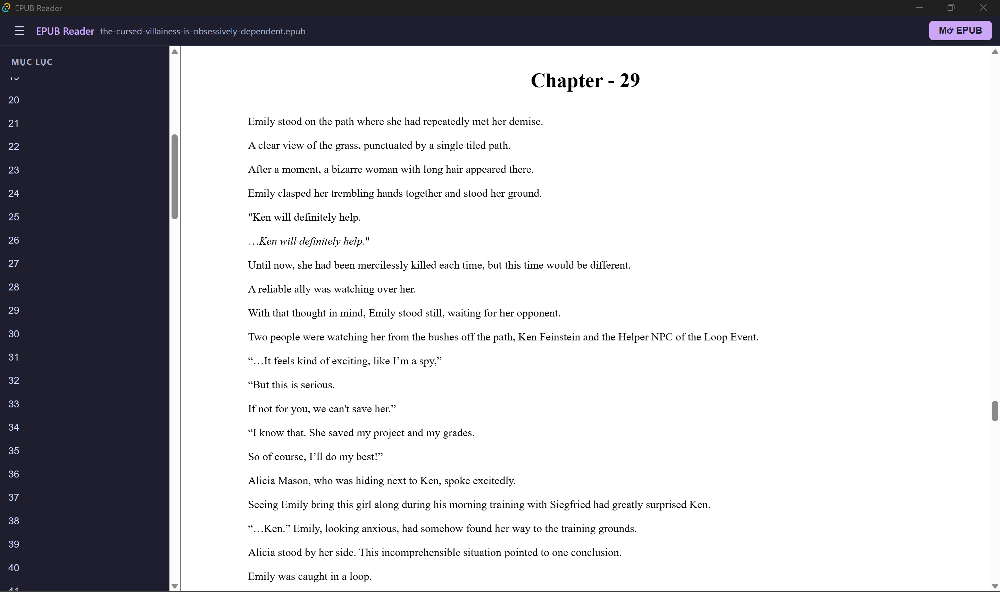
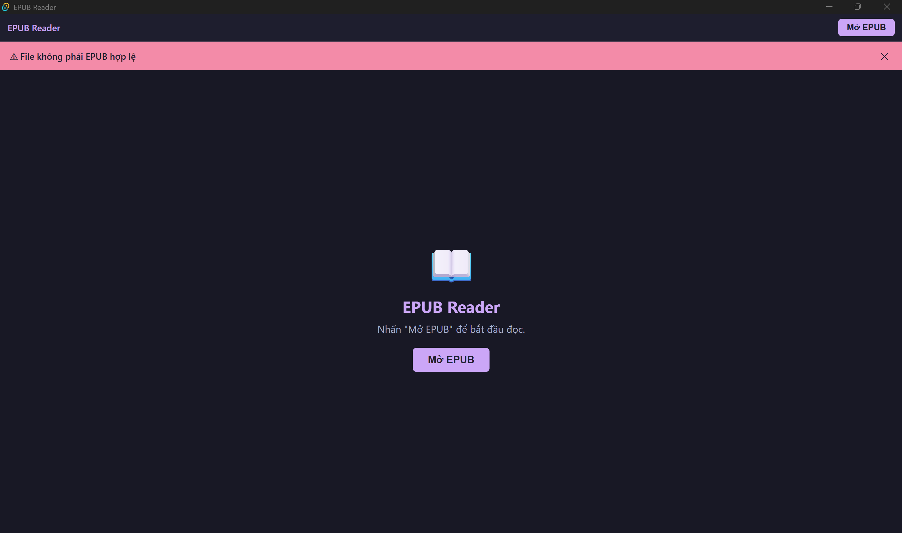

# 📖 EPUB Reader & Translate

Ứng dụng Windows Desktop giúp mở, đọc và dịch sách điện tử định dạng **EPUB** với mục tiêu giữ nguyên cấu trúc trình bày (XHTML, CSS, hình ảnh, font chữ, mục lục) tốt nhất có thể.

---

## ✨ Tính năng hiện tại (MVP 0.1 — Reader)

- **Chạy trực tiếp trên Windows (`.exe`)**: Đã đóng gói bộ cài đặt NSIS (`EPUB Reader_0.1.0_x64-setup.exe`) và file chạy độc lập (`epub-reader.exe`), mở trực tiếp như ứng dụng Windows thông thường mà không cần qua dòng lệnh (CMD/Terminal).
- **Mở file EPUB trực tiếp**: Chọn file `.epub` từ máy tính qua hộp thoại hệ thống (có kiểm tra chữ ký ZIP hợp lệ).
- **Chế độ đọc cuộn liên tục (Scrolled Continuous)**: Hiển thị nội dung 100% chiều rộng vùng đọc, cuộn mượt qua các chương (kể cả sách nhiều hình ảnh).
- **Mục lục đa cấp (TOC Sidebar)**:
  - Hỗ trợ hiển thị cây mục lục nhiều cấp.
  - Nhảy chính xác tới đầu chương ngay từ lần bấm đầu tiên (tự động chờ tải ảnh và căn chỉnh khung nhìn).
  - Chống xung đột khi bấm chuyển nhanh liên tiếp giữa các mục (không bị nhảy ngược).
  - Có thể đóng/mở thanh bên mục lục để tối ưu không gian đọc.
- **Xử lý lỗi an toàn**:
  - Kiểm tra magic bytes (`0x50 0x4B 0x03 0x04`) trước khi nạp file.
  - Cơ chế timeout 20 giây và chống xung đột (race condition) khi mở nhiều file liên tiếp.
  - Hiển thị thông báo lỗi rõ ràng trên giao diện khi gặp file giả/hỏng, không làm treo hay crash ứng dụng.
- **Bảo mật tối thiểu (Least Privilege)**: Chỉ cấp quyền Tauri tối thiểu cần thiết (`dialog:allow-open`, `fs:allow-read-file`).

---

## 🖼️ Giao diện ứng dụng (Screenshots)

### 1. Màn hình chào mừng


### 2. Giao diện đọc sách & Mục lục (Scrolled Mode)


### 3. Cảnh báo lỗi khi mở file không hợp lệ


---

## 🖥️ Cách sử dụng ngay (Không cần dùng CMD / Terminal)

Ứng dụng đã được biên dịch sẵn thành file `.exe` cho Windows (64-bit). Bạn có thể mở và dùng ngay theo 1 trong 2 cách:

1. **Cài đặt vào máy (Khuyến nghị)**:
   - Chạy bộ cài đặt tại: `src-tauri/target/release/bundle/nsis/EPUB Reader_0.1.0_x64-setup.exe` (hoặc tải từ mục **Releases** trên GitHub).
   - Sau khi cài xong, mở **EPUB Reader** trực tiếp từ Desktop hoặc Start Menu của Windows.
2. **Chạy trực tiếp file thực thi (Portable)**:
   - Nháy đúp vào file: `src-tauri/target/release/epub-reader.exe` để mở thẳng ứng dụng mà không cần mở CMD.

---

## 🛠️ Công nghệ sử dụng (Tech Stack)

- **Desktop Framework**: [Tauri 2](https://v2.tauri.app/) (`com.epubreader.desktop` — Rust backend + WebView2)
- **Frontend**: React 19 + TypeScript + Vite
- **EPUB Engine**: `epubjs` (được bọc cô lập sau interface `ReaderEngine` — ADR-004)
- **Tauri Plugins**: `@tauri-apps/plugin-dialog`, `@tauri-apps/plugin-fs`

---

## 📂 Cấu trúc thư mục

```text
Epub file reader/
├── docs/                                 # Tài liệu thiết kế, ADR & trạng thái dự án
│   ├── images/                           # Hình ảnh chụp màn hình ứng dụng
│   ├── DECISIONS.md                      # Các quyết định kiến trúc (ADR)
│   ├── PROJECT_STATE.md                  # Trạng thái tiến độ hiện tại
│   └── PROMPT_01_ANTIGRAVITY.md
├── src/
│   ├── lib/
│   │   └── reader-engine/                # Lớp trừu tượng hóa ReaderEngine (ADR-004)
│   │       ├── ReaderEngine.ts           # Interface chuẩn cho trình đọc
│   │       ├── EpubJsEngine.ts           # Triển khai bằng EPUB.js (nơi duy nhất import epubjs)
│   │       └── index.ts
│   ├── components/
│   │   ├── Sidebar.tsx / Sidebar.css     # Thanh mục lục đa cấp
│   │   └── ReaderView.tsx / ReaderView.css
│   ├── App.tsx                           # Luồng chính: Mở file, quản lý trạng thái & điều hướng
│   ├── App.css                           # Giao diện chính (Dark theme)
│   └── main.tsx
├── src-tauri/                            # Tauri Rust Backend
│   ├── capabilities/default.json         # Cấu hình quyền hạn tối thiểu (dialog, fs:read-file)
│   ├── src/lib.rs                        # Khởi tạo plugin dialog & fs
│   ├── Cargo.toml
│   └── tauri.conf.json                   # Cấu hình định danh & đóng gói bộ cài NSIS
├── PROJECT_BRIEF.md                      # Tóm tắt mục tiêu và nguyên tắc dự án
├── package.json
└── vite.config.ts
```

---

## 💻 Hướng dẫn cho Nhà phát triển (Build từ mã nguồn)

Nếu bạn muốn tự biên dịch hoặc phát triển thêm tính năng từ mã nguồn:

### 1. Yêu cầu môi trường (Prerequisites)
- **Hệ điều hành**: Windows 10/11 (có sẵn Microsoft Edge WebView2)
- **Node.js**: `>= 18.x`
- **Rust & Cargo**: Cài đặt qua [rustup.rs](https://rustup.rs/)
- **Visual Studio C++ Build Tools**: Chọn workload *"Desktop development with C++"*

> **Lưu ý trên Windows**:
> - *Smart App Control (SAC)* trên Windows có thể chặn build script của Cargo nếu đặt project trong thư mục `Downloads`.
> - Dữ liệu `localStorage` giữa bản chạy thử (`tauri dev`) và bản cài đặt (`.exe`) là tách riêng nhau.

### 2. Cài đặt & Chạy thử
```bash
# Cài đặt dependencies
npm install

# Chạy chế độ phát triển (Dev)
npm run tauri dev

# Kiểm tra kiểu TypeScript & Build Frontend
npx tsc --noEmit
npm run build

# Đóng gói bộ cài đặt Windows (.exe NSIS)
npm run tauri build
```

---

## 🗺️ Lộ trình phát triển (Roadmap)

- [ ] **MVP 0.1 (Reader — Đang hoàn thiện)**:
  - [x] Mở và đọc EPUB trên Windows Desktop, cuộn liên tục, mục lục đa cấp chuẩn xác, xử lý lỗi file giả/hỏng, đóng gói bộ cài `.exe` (NSIS).
  - [ ] Sửa lỗi khôi phục vị trí đọc (CFI) khi đóng và mở lại sách.
  - [ ] Cân nhắc bổ sung danh sách sách mở gần đây (Proposal).
- [ ] **Milestone tiếp theo (Lựa chọn)**:
  - Hoàn thiện trải nghiệm Reader.
  - Dịch nội dung EPUB sang tiếng Việt (hướng ưu tiên: Gemini API), giữ nguyên cấu trúc HTML/CSS/hình ảnh, hiển thị tiến trình (`%`, `ETA`) và xuất file EPUB đã dịch.
  - Spike phân tích sâu cấu trúc EPUB.

---

## ⚠️ Giới hạn đã biết (Known Limitations)

1. **Khôi phục vị trí đọc**: Tính năng tự động cuộn về vị trí đọc cuối khi mở lại sách đang được sửa (hiện cần bấm chọn một chương trong mục lục khi mở lại sách đã lưu vị trí).
2. **Sách có DRM**: Không hỗ trợ mở các file EPUB bị khóa bản quyền (Adobe DRM, Apple FairPlay...).
3. **Sách Fixed-Layout**: Một số sách dàn trang cố định có thể hiển thị khác biệt ở chế độ cuộn dọc.

---

## 📄 Giấy phép (License)

Xem chi tiết trong file [LICENSE](./LICENSE).